<div align="center">

# Natour

### Describe the trip. Walk it.

An AI trip planner that can't make places up. Describe a trip in a sentence and Natour plans it day by day on a map, looking every suggested place up on OpenStreetMap and dropping the ones that don't exist. Drag stops between days, lock favourites, ask for a rainy-day version, compare neighbourhoods to stay in, pack from real climate averages, rough out a budget, and keep a journal afterwards that never leaves your device. No account needed.

**[natour.ewstudios.workers.dev](https://natour.ewstudios.workers.dev)** · [The shared API](https://github.com/emwil23/ew-apps-api)


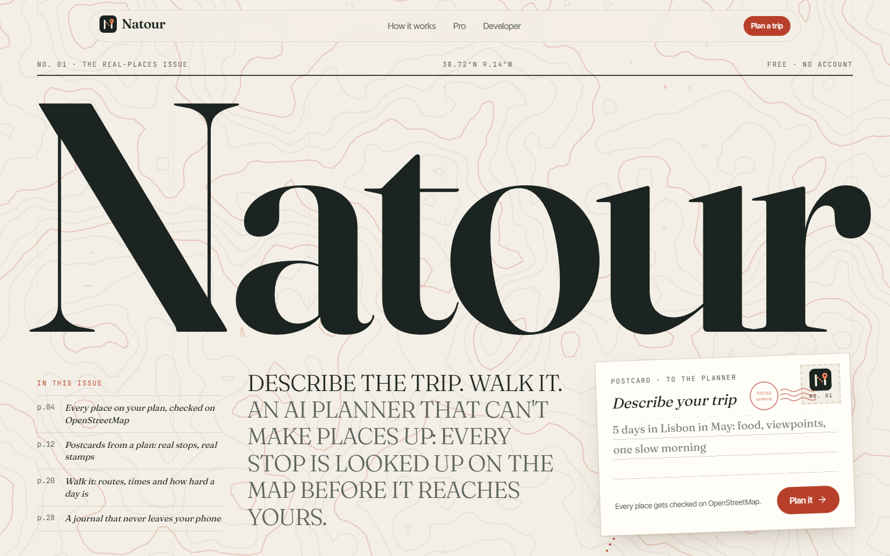

</div>

## The idea

Natour started in 2021 as three CSS exercises from the same course: _natour_, a tour-booking landing page whose form went nowhere; _Trillo_, a hotel page with made-up reviews and "only 4 rooms left"; and _Nexter_, a homes page that survived only as built files. None of it did anything. What was worth keeping was the travel idea, natour's Easy / Medium / Hard tours, and "where to stay".

So those became a planner. The tours' difficulty is now how much walking a day takes. "Where to stay" became a comparison of three neighbourhoods measured against your own stops. And the fake reviews and scarcity went the other way: Natour shows nothing invented as fact. The AI writes the plan, but every place it names is looked up on OpenStreetMap inside your destination before it reaches you, and a stamp with its coordinates proves it.

| From             | What Natour takes                                                     |
| :--------------- | :-------------------------------------------------------------------- |
| Wanderlog        | A day-by-day plan on a map, with drag to reorder                      |
| Mindtrip / Layla | Plan from a sentence, here with every place checked                   |
| TripIt           | Everything for one trip in one place: plan, stay, packing, budget     |
| Roadtrippers     | Walking times between stops, and "add a stop on the way"              |
| Polarsteps       | A journal after the trip, with the route drawn                        |
| Google Travel    | The best months to visit, here from 25 years of NASA climate averages |

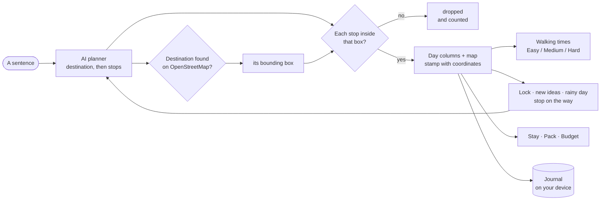

## A walk through

|                                                                                                                                                                                                                                                                                                                                                                                                                                                                                                                                                                                                   |                                                                                                                                                                                                                                                                                                                                           |
| :------------------------------------------------------------------------------------------------------------------------------------------------------------------------------------------------------------------------------------------------------------------------------------------------------------------------------------------------------------------------------------------------------------------------------------------------------------------------------------------------------------------------------------------------------------------------------------------------ | :---------------------------------------------------------------------------------------------------------------------------------------------------------------------------------------------------------------------------------------------------------------------------------------------------------------------------------------- |
|  | 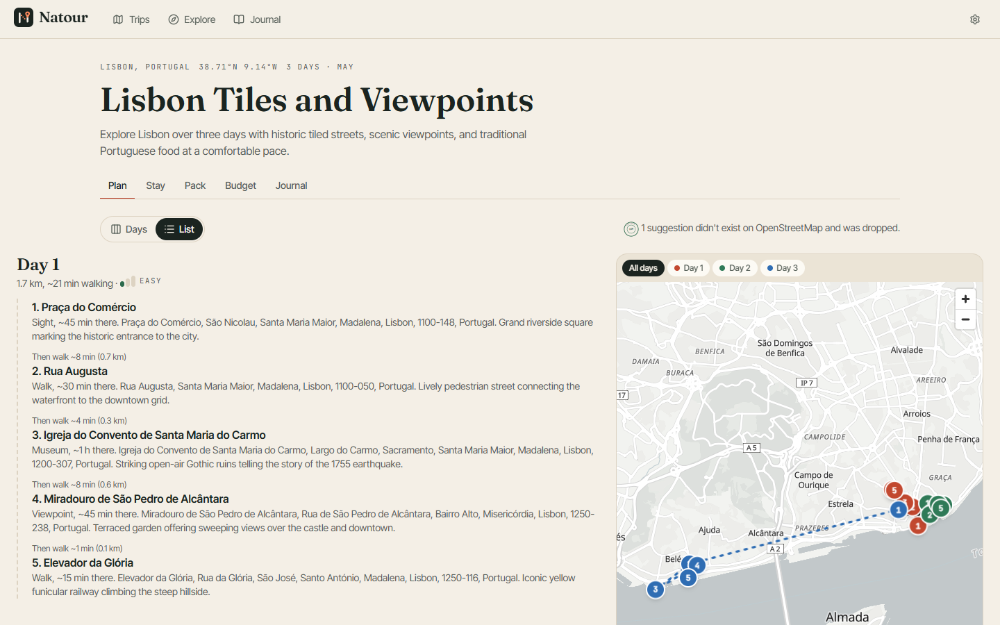                                                                                                     |
| **The planner.** Every stop carries a stamp with its coordinates; the place's spelling is OpenStreetMap's. Drag stops between days (keyboard too), lock favourites, ask for new ideas or a stop on the way.                                                                                                                                                                                                                                                                                                                                                                                       | **List view.** The accessible view of the map: every day in words, with estimated walks between stops.                                                                                                                                                                                                                                    |
| 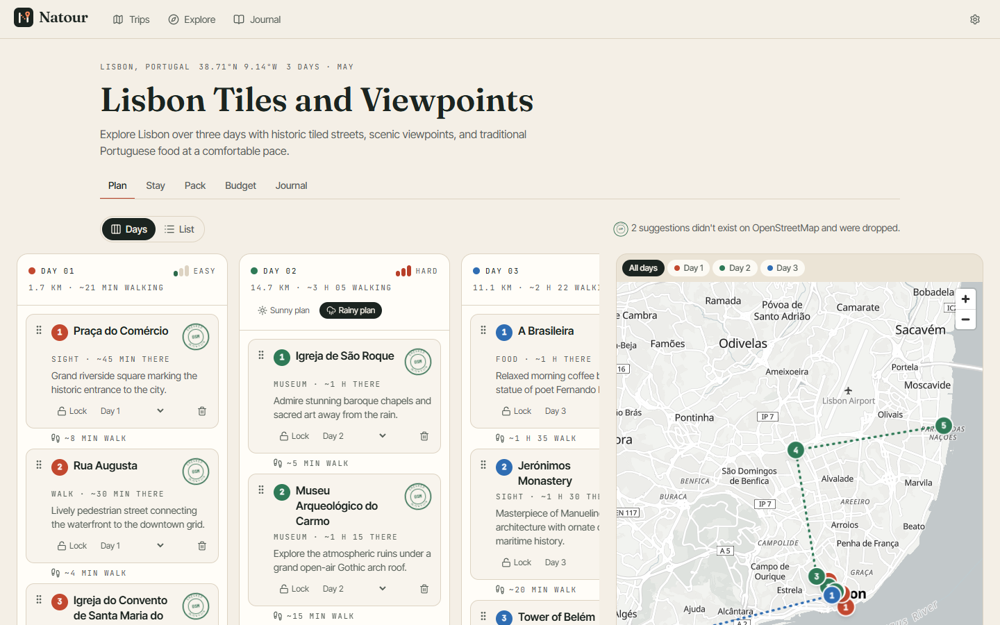                                                                                                                                                                                                                                                 | 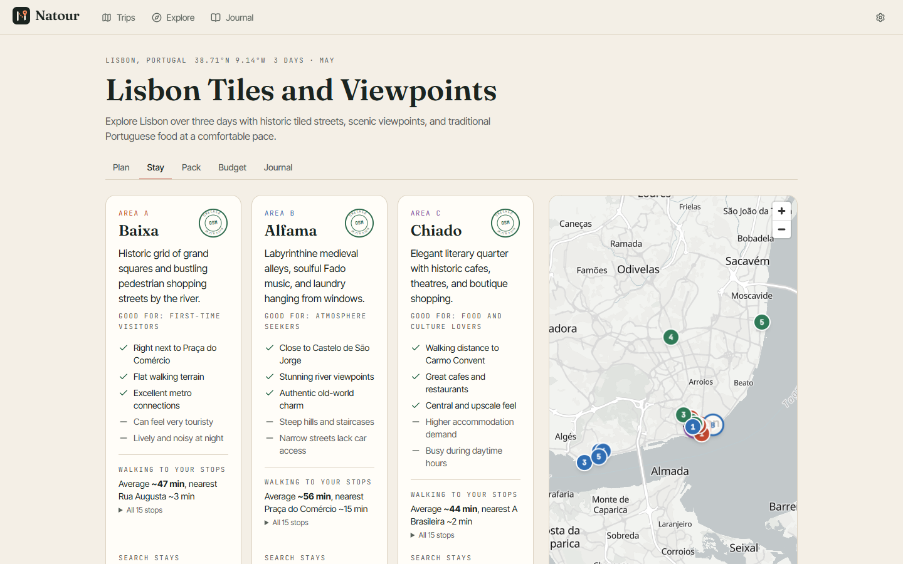 |
| **A rainy-day version.** Indoor and covered places near the planned ones, a tap to switch back.                                                                                                                                                                                                                                                                                                                                                                                                                                                                                                   | **Where to stay.** Three areas compared by the AI; the walking times to your stops are measured by the app. Plain search links, no prices or reviews.                                                                                                                                                                                     |
| 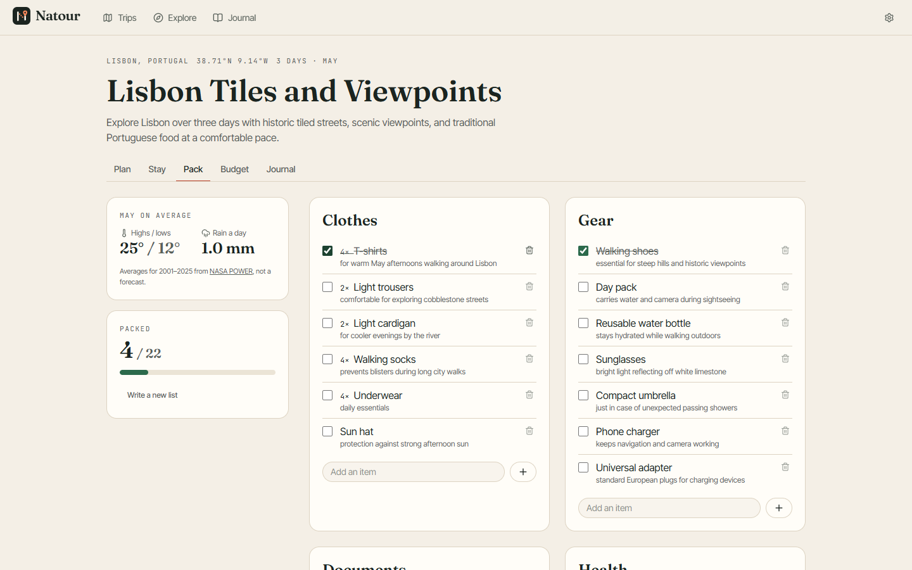                                                                                                                                                                                                                                                                                                                                  | 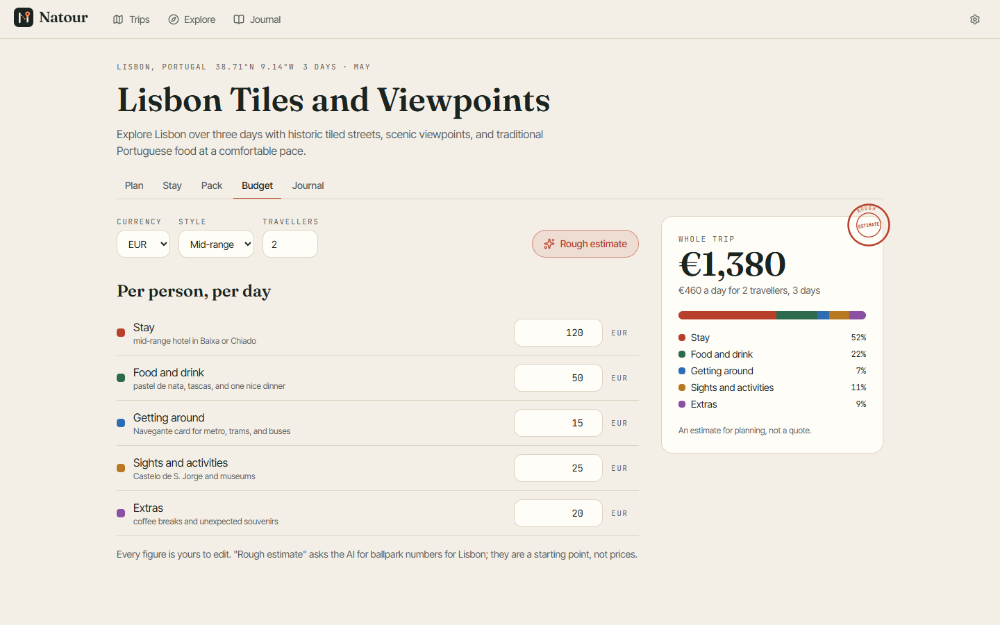                                         |
| **Pack.** A list from the month's climate averages, the trip's activities and its length. Ticks stay on the device.                                                                                                                                                                                                                                                                                                                                                                                                                                                                               | **Budget.** A rough estimate you can edit, in your currency, totalled for the group and the trip.                                                                                                                                                                                                                                         |
| 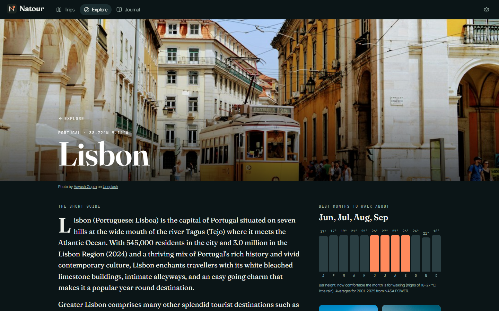                                                                                                                                                                                                                                                                                                    | 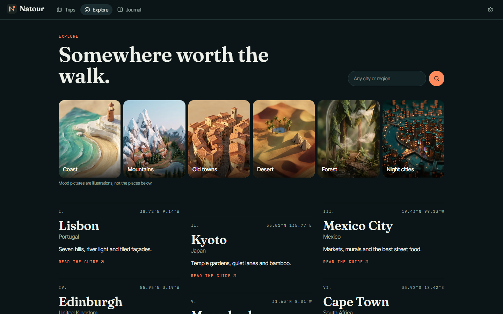                         |
| **Destination guides.** A real photo with credit, Wikivoyage's introduction (CC BY-SA, linked) and the best months from NASA climate averages.                                                                                                                                                                                                                                                                                                                                                                                                                                                    | **Explore.** Start from a feeling; any other city works through search.                                                                                                                                                                                                                                                                   |
| 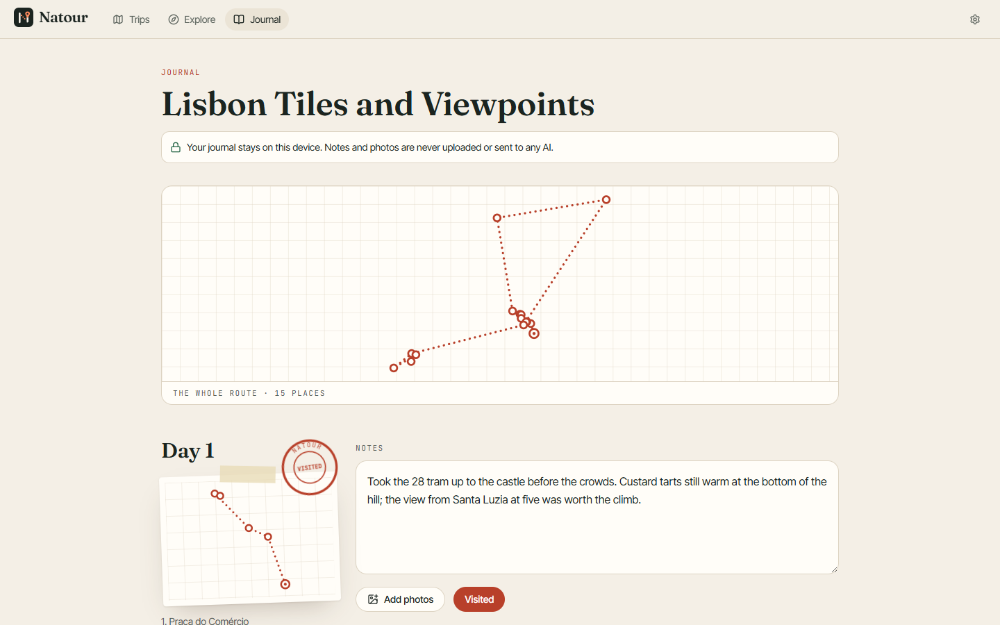                                                                                                                                                                                                                                                                                                                                        | 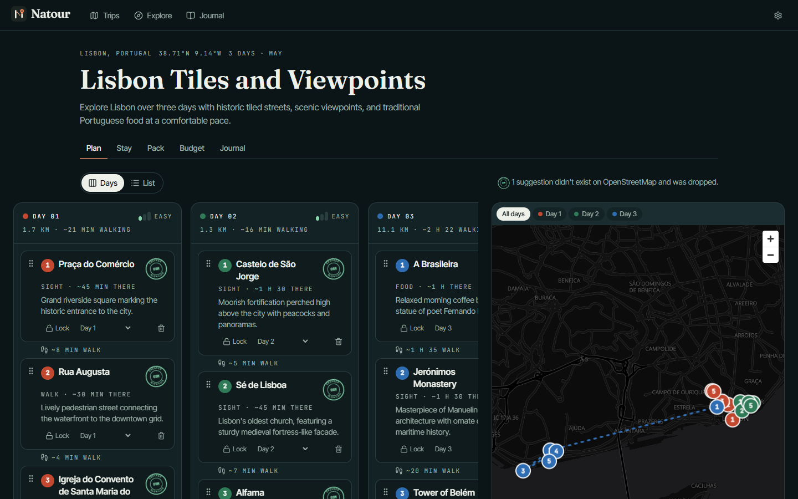                                                                                                                                                                                                                 |
| **The journal.** Notes and photos per day, beside the route you walked. Stored in IndexedDB only.                                                                                                                                                                                                                                                                                                                                                                                                                                                                                                 | **Night theme.** Both themes pass WCAG AA on every page, checked by axe in CI.                                                                                                                                                                                                                                                            |
| 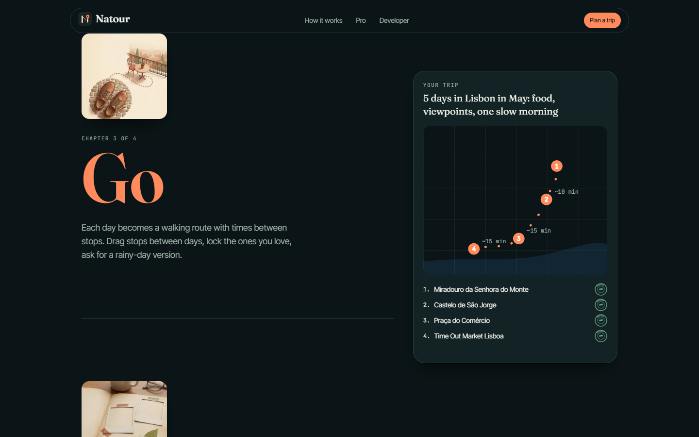                                                                                                                                                                                                                                                              | 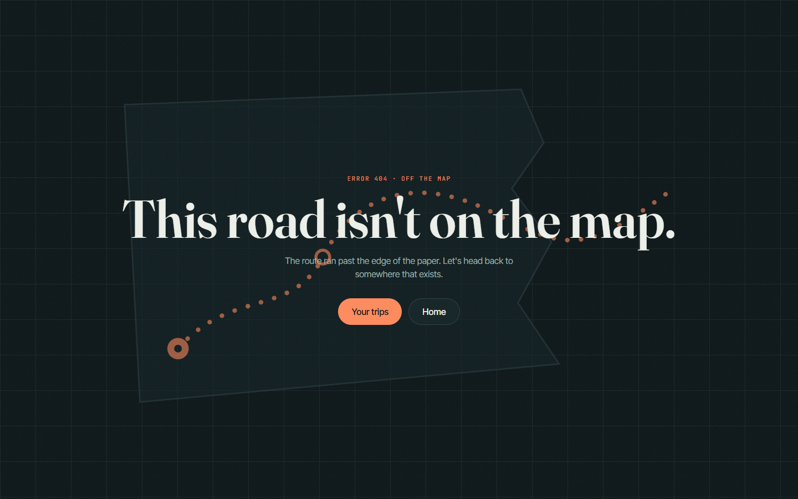                                                                                                                                                           |
| **The scroll story.** Dream, Plan, Go, Remember, each with a live demo.                                                                                                                                                                                                                                                                                                                                                                                                                                                                                                                           | **404.** Off the map.                                                                                                                                                                                                                                                                                                                     |

<p align="center">
  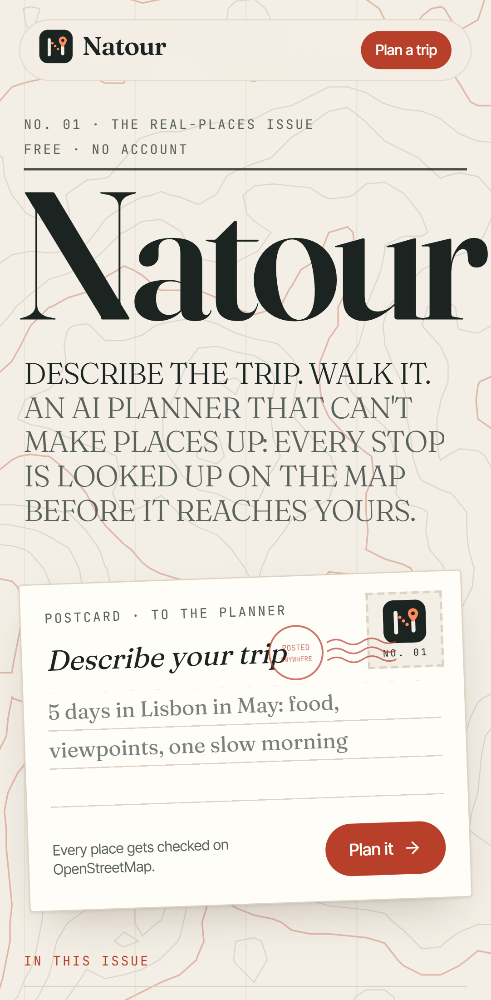
  &nbsp;
  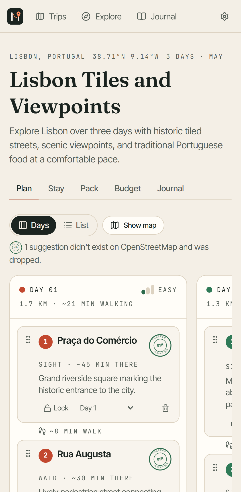
  &nbsp;
  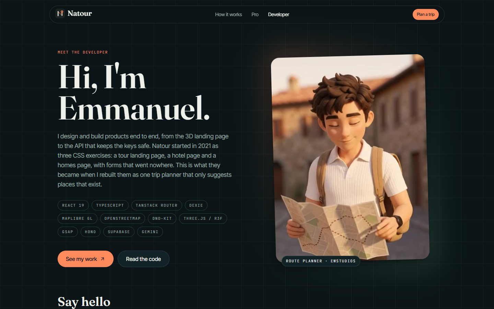
</p>

## How it is built

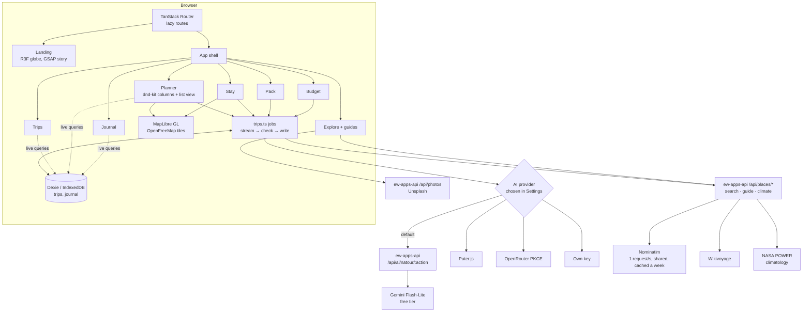

One plan, from a sentence to stamped stops:

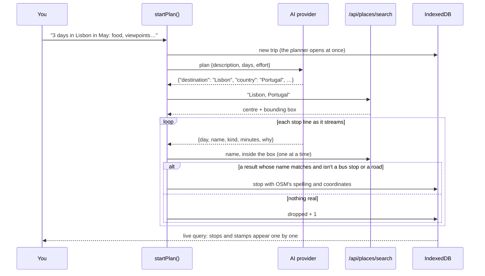

Nominatim allows one request a second for the whole app, so the API keeps one clock for everybody:

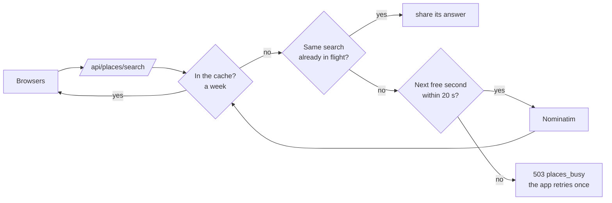

## Decisions worth explaining

- **The AI can't add a place that doesn't exist.** The model names places; `src/lib/check.ts` decides. Each name is searched on Nominatim inside the destination's bounding box, and a result counts only if at least half the suggested name's words (accents, punctuation and filler words like "de" or "the" removed) are in its OpenStreetMap name, and it isn't a bus stop, a platform or a road named after the place. The stop then takes OpenStreetMap's spelling and coordinates. On the recorded Gemini plan for Lisbon (the one in the screenshots), one suggestion wasn't on the map and was dropped, and every other stop took OpenStreetMap's name and coordinates. If our server can't check (offline, or Nominatim busy), the stop is kept but marked "not checked" and gets no pin, instead of failing the plan.
- **The terms of each data source shaped the app.** Read on 2026-10-23 ([docs/data-terms.md](docs/data-terms.md)). OpenFreeMap allows commercial use with attribution. Nominatim allows one request a second, no autocomplete and no bulk use, so place search runs on submit only, through one shared, cached queue. The public Overpass server and the OSRM demo router are for non-commercial use, and Natour has a paid Pro pass, so neither is used: walking times are estimated in code (straight-line distance × 1.3 for the streets, at 4.8 km/h) and always shown with a "~". Open-Meteo's free plan counts any app with a subscription as commercial, so the climate comes from NASA POWER's monthly averages instead.
- **Jobs run outside React.** Planning, replanning a day, the rainy-day version, stays, packing and the budget are functions in `src/lib/trips.ts` that stream the AI's JSON lines, check each place and write into IndexedDB as they go. Pages only watch the trip with a live query, so you can switch tabs while a plan fills in, and two tabs show the same progress. A job interrupted by closing the tab is cleared with a note on the next visit.
- **Drag and drop with a keyboard, and a list instead of a map.** Day columns use dnd-kit with its keyboard sensor (Space, arrows, Space), and every stop also has a "Move to day" menu. The map is extra for sighted mouse and touch users: the List view says the same thing in words, with walking times between stops. axe runs on every page in both themes in CI.
- **Nothing invented is shown as fact.** Neighbourhoods come with vibes, pros and cons, but distances to your stops are computed by the app, not the AI. "Search stays" opens a plain Booking.com or Airbnb search; there are no prices, ratings, reviews or scarcity anywhere. The budget is the AI's ballpark, editable, and stamped ESTIMATE.
- **Real places get real photos.** Destination pages use Unsplash photos through the shared API, hotlinked and credited to the photographer as Unsplash requires. The AI-generated pictures are mood tiles drawn as miniature dioramas, so they never pass for a real place, and the page says so.
- **The journal stays home.** Notes and photos are kept in IndexedDB only; photos are shrunk to 1600 px on the device first. The AI only ever sees the trip description, the destination, days, month and place names, never the journal.
- **The globe is baked, not downloaded.** The landing globe's 4,600 land dots come from Natural Earth's 1:110m land shapes, sampled once on a Fibonacci sphere by `scripts/land-dots.mjs` into a 16 kB (gzipped) list. The 3D scene loads after first paint, on a real GPU only, never with reduced motion; otherwise the Flow still is shown.
- **One account for every EWSTUDIOS app, email code only here.** Sign-in exists only for the free AI server's daily quota; Natour shows no passkey button and signs in with the emailed code.

## Data and credits

- Map data © [OpenStreetMap contributors](https://www.openstreetmap.org/copyright), under the ODbL; place search by [Nominatim](https://nominatim.org/).
- Map tiles by [OpenFreeMap](https://openfreemap.org/), © OpenMapTiles.
- Guides from [Wikivoyage](https://en.wikivoyage.org/), by its contributors, under [CC BY-SA 4.0](https://creativecommons.org/licenses/by-sa/4.0/); each guide links to its article.
- Climate averages: data obtained from the NASA Langley Research Center [POWER](https://power.larc.nasa.gov/) Project, funded through the NASA Earth Science Division (Climatology API, 2001–2025).
- Destination photos from [Unsplash](https://unsplash.com/), credited to each photographer.
- Globe land shapes from [Natural Earth](https://www.naturalearthdata.com/) (public domain).

The same credits are in the app's footer, on the map, next to each guide and photo, and on the Terms page.

## Two versions

| Version           | Concept                                                                                                         | Why it changed                                               |
| :---------------- | :-------------------------------------------------------------------------------------------------------------- | :----------------------------------------------------------- |
| v1 (2021)         | Three CSS course exercises: a React 17 tour landing page (natour), a hotel page (Trillo), a homes page (Nexter) | No logic, forms that went nowhere, fake reviews and scarcity |
| **v2 (Oct 2026)** | An AI trip planner whose every place is checked on OpenStreetMap, with stays, packing, budget and a journal     | Live                                                         |

## How it was made

Built in conversation with [Claude Code](https://claude.com/claude-code), which wrote and tested the code. The design direction came from Awwwards references (Hedwig, The Explora Journal, EXOLAUNCH Orbit Explorer, Dérive, Mammut Local Adventure; see [docs/design-brief.md](docs/design-brief.md)). The art and clips were generated in Google Flow (Nano Banana Pro and Omni 1.1 Flash); [docs/assets.md](docs/assets.md) lists every prompt. The logo and icons are SVG. The screenshots show real OpenStreetMap lookups, real Wikivoyage, NASA and Unsplash data, and real Gemini answers to the server's own prompts.

## Run it

```bash
npm install
```

```bash
npm run dev
```

```bash
npm test
```

```bash
npm run e2e
```

Node 24. Copy `.env.example` to `.env` and point `VITE_API_URL` at a running [ew-apps-api](https://github.com/emwil23/ew-apps-api): it carries the place checks, guides, climate, photos and the free AI option. Without an AI provider you can still start an empty trip and add places yourself. `npm run build` also prerenders the public pages, so it needs Playwright's Chromium (`npx playwright install chromium`). `npm run e2e` answers every place lookup, guide, climate call, map tile and AI request inside the test, so it needs no keys or network; it covers describe → plan (with a made-up place dropped) → reorder by menu and by keyboard drag → list view, packing, budget maths, stays, the journal, explore, and axe on every page in both themes. CI adds lint, typecheck, unit tests and Lighthouse (≥ 0.95 in every category). Deploy with `VITE_API_URL=https://ewandtina-d9aa187632ca.herokuapp.com npm run build && npx wrangler deploy` (config in `wrangler.jsonc`).

`node scripts/screenshots.mjs` retakes the pictures in `docs/` against a served build, with real place data from a local API and the recorded Gemini answers in `scripts/screenshot-fixtures.json`.

## Where things are

```
src/
├─ main.tsx              router.load(), then hydrate or render
├─ router.tsx            every route, lazily loaded
├─ index.css             design tokens for paper and night, fonts, graticule, stamps
├─ ai/                   actions + templates, providers, JSON Lines, PKCE, Supabase sign-in
├─ lib/                  trips (AI jobs), check (is it real?), geo (walking times), budget, climate,
│                        api (places, guides, photos), destinations, Dexie
├─ landing/              the 3D globe, its baked land dots, the scroll story, smooth scroll
├─ components/           shells, trip frame, MapLibre map, stamps, route sketches, effort bar
└─ pages/                Landing, Trips, Planner, Stay, Pack, Budget, Explore, Destination, Journal,
                         Settings, Developer, Pro, Legal, 404
scripts/
├─ prerender.mjs         static HTML for the public pages
├─ land-dots.mjs         bakes the globe's land dots from Natural Earth
└─ screenshots.mjs       the README pictures
e2e/                     Playwright flows with mocked place, map and AI hosts, and axe checks
docs/                    brief, design brief, data terms, asset list, screenshots
```

<div align="center">

Made with ♥ by EWSTUDIOS

</div>
